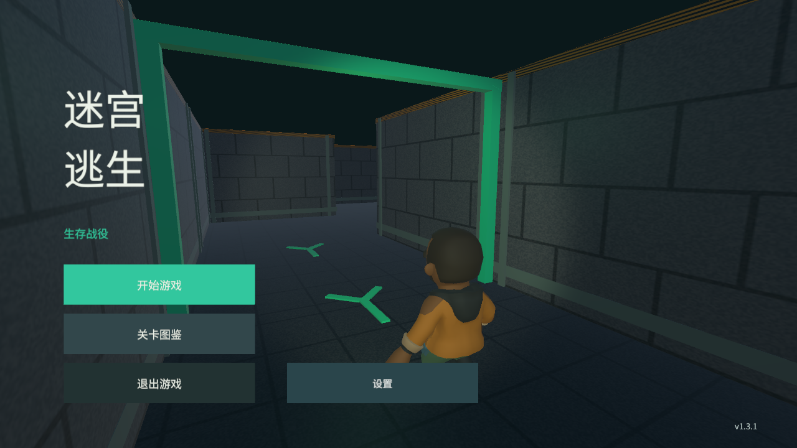

# 迷宫逃生 / Maze Escape

使用 Unity 6 与 C# 开发的 3D 地下城生存迷宫作品。玩家同时携带栓动狙击枪和长刀进入程序化生成的地下设施，在局部雾区、断电、污染和具备感知记忆的僵尸压力下寻找出口。游戏支持第一/第三人称切换、十关顺序解锁和本地进度保存。

**当前正式版仍为 v1.3.1；v1.4.0 为功能分支发布候选。** v1.4.0 新增默认长刀开局、栓动狙击枪随时切换、5 发弹匣与手动换弹、右键配镜和短时专注减速、自适应武器 HUD、声音感知、视线遮挡、目标记忆、搜索、有限群体警报、Utility AI，以及替代短局昼夜循环的固定地下城环境状态。

- [下载 GitHub Release v1.3.1](https://github.com/ff1333/MazeEscape/releases/tag/v1.3.1)
- [作品集演示视频](https://github.com/ff1333/MazeEscape/releases/download/v1.3.1/MazeEscape-v1.3.1-portfolio-720p.mp4)（中文旁白与字幕）
- [v1.3.1 发布说明](docs/RELEASE_NOTES_v1.3.1.md)
- [v1.4.0 候选版说明](docs/RELEASE_NOTES_v1.4.0.md)
- [v1.4.0 自动验证证据与发布边界](docs/test-results/v1.4.0/README.md)
- [v1.3.0 设置与开发记录](docs/13_V1_3_0_SETTINGS.md)
- [v1.3.0 自动测试、平台构建与验收边界](docs/test-results/v1.3.0/README.md)
- [文档阅读入口](docs/README.md)




## 核心玩法

- 十关确定性迷宫，每关使用不同固定种子、尺寸和难度参数
- 开始页、十关选择、机制图鉴、默认长刀准备和本地顺序解锁
- Growing Tree 程序化生成，并筛选路线长度、转弯和分岔质量
- 探索小地图记录走过的区域，不直接暴露完整出口路线
- 第一人称与第三人称切换，共用输入、瞄准和伤害逻辑
- 默认同时携带栓动狙击枪与长刀，支持随时切换、单发拉栓、手动换弹、配镜瞄准、备用弹药、命中反馈和遮挡判断
- 普通与精英僵尸通过视觉锥、墙体遮挡、听觉、目标记忆、Utility AI 和网格 A* 行动
- 对象池按关卡敌人上限预热，复用僵尸实例
- 后期关卡逐步加入局部雾区、应急红灯、断电、污染、封锁和全图避难灯
- Windows、WebGL、Android 操作与构建支持
- 默认中文，可切换英文；声音开关和分组音量本地保存

## 操作方式

### Windows / WebGL

- `WASD`：移动
- 鼠标：转向和瞄准
- 鼠标左键：长刀攻击；狙击枪单击发射一枪，每枪后自动拉栓
- 鼠标右键：狙击枪配镜；刚开镜 3 秒内游戏速度为 0.5 倍
- `1` / `2` 或鼠标滚轮：切换狙击枪与长刀
- `Shift`：冲刺
- `R`：手动换弹；空弹不会自动装填
- `V`：切换第一/第三人称
- `Esc`：暂停并释放鼠标

### Android

- 左侧浮动摇杆：移动
- 滑动屏幕：转动视角
- 狙击枪、长刀、攻击、配镜、冲刺、装弹和视角按钮：执行对应动作

## 工程设计

### 程序化迷宫

关卡使用不同固定种子生成，确保每关布局不同，同时让同一问题能够复现。Growing Tree 算法先保证逻辑连通，再通过候选筛选控制路线长度、早期选择点、转弯和分岔密度。PlayMode 还会驱动实体角色沿路线移动，用来发现“逻辑可达但碰撞体挡住入口”的问题。

### 寻路与敌人 AI

僵尸复用迷宫逻辑网格执行 A*，不需要在每次生成后重新烘焙 NavMesh。`EnemyPerception` 负责视野角、距离、遮挡、声音和目标记忆，`EnemyDecisionModel` 为巡逻、调查、搜索、追击和攻击评分，`EnemyAgent` 只执行最终意图。狙击枪声传播 42 米，长刀和冲刺脚步声范围更小；警报只共享可疑位置并受半径和冷却限制。对象复用时重置生命、路径、感知和状态，避免池化污染。

### 相机与战斗

两种视角共享战斗规则。远程攻击先从相机准心确定瞄准点，再从枪口检查真实遮挡，减少第三人称越墙命中。第一人称眼位保持在角色碰撞胶囊内并使用更小近裁剪面，避免贴墙时镜头越过墙体。狙击枪为 5 发弹匣、20 发备弹、高伤害单发武器，每枪后必须完成拉栓，换弹只能由玩家明确触发；右键配镜会缩小 FOV，并在每次刚开镜的 3 秒内提供 0.5 倍时间流速。HUD 显示拉栓、装弹和专注状态，角色通过骨骼支撑手 IK 双手持械，未使用武器背在背后。

### 环境难度

短局昼夜循环被移除。每关使用固定的供电、低照明、应急红灯、断电、污染、封锁或地下深层状态。局部雾区通过场景粒子和 HUD 后层雾幕明确表现，并同步降低该区域内僵尸视野。污染关卡仍要求玩家在避难灯之间规划路线；灯柱分布不等同于出口指示。

### 本地化与设置

`PortfolioSettings` 管理默认值和 PlayerPrefs，`LocalizedLabel` 负责中英文刷新及中文字体，设置面板提供静音、总音量、音乐与音效音量。静音不会清空原滑块值，重新开启声音后恢复此前音量。

## 当前验证结果

- v1.4.0 EditMode：`21/21 PASS`
- v1.4.0 PlayMode：`42/42 PASS`
- v1.4.0 Windows Development：构建成功，0 errors，0 warnings
- Windows 独立 Player：默认长刀、双手持械与背负武器、配镜画面、拉栓/换弹状态和地下环境截图通过检查
- v1.4.0 Android、WebGL 和真人完整试玩尚未执行，不能视为正式发布完成
- WebGL：Edge 中完成设置、图鉴、选关、选武器、移动、攻击、装弹和暂停交互，未捕获游戏异常
- Android：作者已完成一次 v1.3.0 真实设备基本验收，未发现阻塞发布的问题

正式版证据仍见 [v1.3.1 验证索引](docs/test-results/v1.3.1/README.md)，本轮证据见 [v1.4.0 候选版验证记录](docs/test-results/v1.4.0/README.md)。v1.4.0 当前属于候选版，自动测试和 Windows 冒烟不能替代真人手感、Android 真机、多机型、长时间压力或商店审核。

## 项目结构

```text
Assets/
  Art/             CC0 角色、僵尸、武器和项目视觉资源
  Editor/          平台构建脚本
  Scenes/          主场景 Main.unity
  Scripts/         生成、寻路、战斗、相机、UI、设置和存档代码
  Tests/           EditMode 与 PlayMode 自动测试
docs/
  devlogs/         各轮需求、修复和验证记录
  images/          历史版本实际运行截图
  test-results/    各版本测试 XML、截图和构建摘要
```

## 本地运行

1. 安装 Unity `6000.3.18f1` 及需要的平台模块。
2. 使用 Unity Hub 打开仓库根目录。
3. 等待资源导入和脚本编译完成。
4. 打开 `Assets/Scenes/Main.unity`。
5. Console 没有红色错误后，点击 Unity 顶部三角形 Play。

正式包位于 [GitHub Release v1.3.1](https://github.com/ff1333/MazeEscape/releases/tag/v1.3.1)。Windows ZIP 需要完整解压后运行 `MazeEscape.exe`；WebGL ZIP 需要 HTTP 静态托管；Android APK 为作品集测试分发包。

## 素材与能力边界

- 角色、两类僵尸、武器模型、共享色板和角色动画来自 Quaternius Zombie Apocalypse Kit，采用 CC0 1.0；中文字体采用 SIL OFL 1.1。详情见 [THIRD_PARTY_NOTICES.md](THIRD_PARTY_NOTICES.md)。
- 本项目负责素材集成、玩法、生成、寻路、战斗、UI、测试和交付，不将外部模型宣称为本人建模。
- 当前是单机作品集项目，没有联网同步、服务器、热更新和完整商业化系统。
- v1.2.2、v1.2.1、v1.2.0 和 v1.1.0 文档保留用于展示迭代历史，不代表当前版本。

## 历史版本

- [从主菜单到十关迷宫的完整代码与开发解释](docs/PROJECT_DEVELOPMENT_EXPLAINED.md)

- [v1.2.2：避难灯与装弹反馈](docs/12_V1_2_2_LIGHTS_AND_RELOAD.md)
- [v1.2.1：右手武器、命中与遮挡修复](docs/11_V1_2_1_WEAPONS.md)
- [v1.2.0：关卡图鉴与战斗表现](docs/10_V1_2_0_POLISH.md)
- [v1.1.0：开始页、十关选择和动画角色](docs/09_V1_1_0_MENU_AND_CHARACTERS.md)
